# Filly

*Your filament friend.* A Home Assistant add-on for tracking 3D printer filament inventory, monitoring print history, and calculating material costs. Integrates natively with Bambu Lab printers via **Bambu Lab Cloud (MQTT)**.

 

> **Fork notice:** This is a personal fork of [cgradl/filament-manager](https://github.com/cgradl/filament-manager) (MIT, based on v0.41.3). It uses its own version series starting at 1.0.0 and is installed as a separate add-on ("Filly", formerly "Filament Manager (Fork)"). All credit for the original add-on goes to cgradl; fixes that fit the original are offered back upstream as pull requests.

---

## What is different from the original

The original (0.41.3) tracks spools, prints, projects and costs. This fork keeps all of that and adds:

| Area | Original 0.41.3 | This fork |
|---|---|---|
| **Spools page** | 21-column table, one filter per column | One bar for tiles **and** list: search, filter chips with counts (Active / Moist / Low / In AMS / Archived), material and location filter, sort menu, summary line; detail column (laptop) or bottom sheet (phone) with every action |
| **Moisture** | last drying date only | Estimated dryness per spool (material × packaging × time), dryer workflow ("Into dryer" / "Done drying"), warning thresholds, HA sensor |
| **Costs** | filament + energy | plus **printer wear** per print hour, **per-spool tare**, estimated material cost for prints without a spool, **cost overview per project as PDF** (switchable items, extra line items), **inventory list as PDF** |
| **Labels** | – | **QR labels** for spools (30×15 mm and other sizes, print profiles), print directly on a **Niimbot D110** over Web Bluetooth, or as PNG / PDF / A4 grid; the QR code opens the spool |
| **Maintenance** | – | **Maintenance log**: recurring tasks due by print hours, days or grams (first reached wins), A1 template, HA sensor |
| **Home Assistant** | 3 sensors | plus **long-term statistics** sensors (filament, prints, hours, costs, stock) and a statistics snapshot for dashboards, moisture and maintenance sensors |
| **AMS** | slot as free text | slot as dropdown of the printer's real trays, assignment straight from the spool list |
| **Look & feel** | fixed colours, browser dialogs | Home-Assistant-style theme tokens (light / dark), own confirmation dialog, **"Undo" toasts** instead of confirm/alert, numbers in the UI language, **bottom navigation on the phone** |
| **Speed** | one 1.3 MB bundle | pages load on demand (start bundle ≈ 0.46 MB), charts and label code only when needed |
| **Code** | very large page files | `Settings`, `Spools` and `Prints` split into focused components |

The full list per version is in the [CHANGELOG](filament_manager/CHANGELOG.md).

---

## Screenshots

Screenshots show demo data, not a real inventory.

**Dashboard**

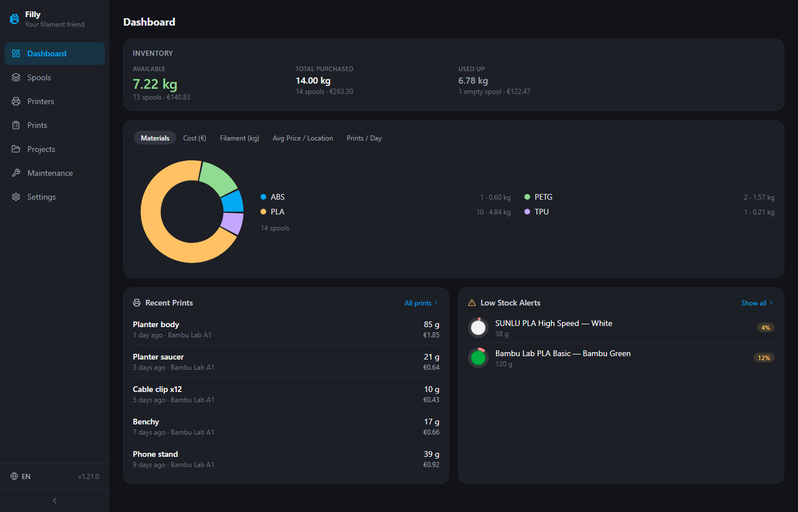

**Spools: tiles**

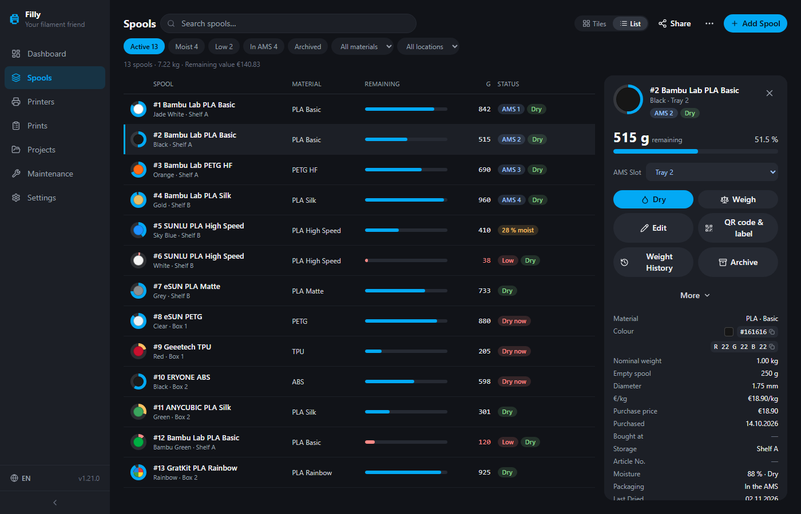

**Spools: list with detail column**


**Manufacturer colours (about 2,000 colours, official or community)**

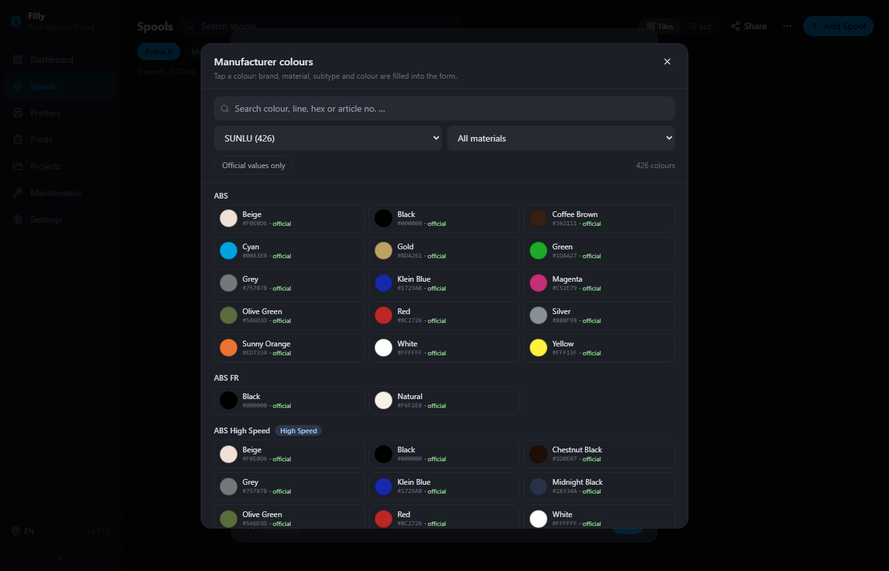

**Labels (QR code, Niimbot D110, PNG / PDF)**

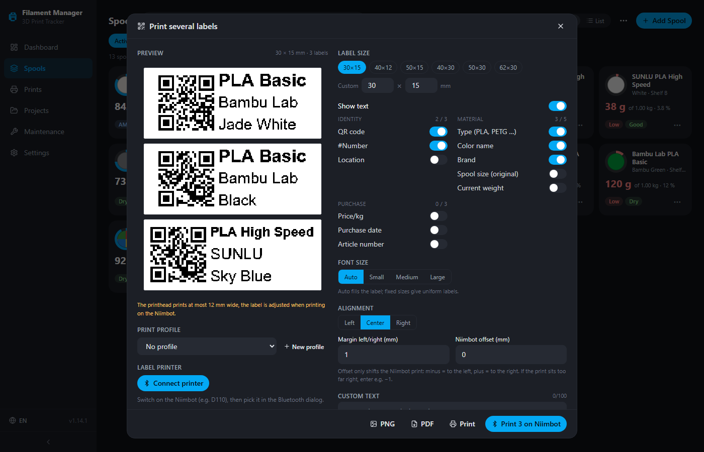

**Printers: live print and AMS slots**

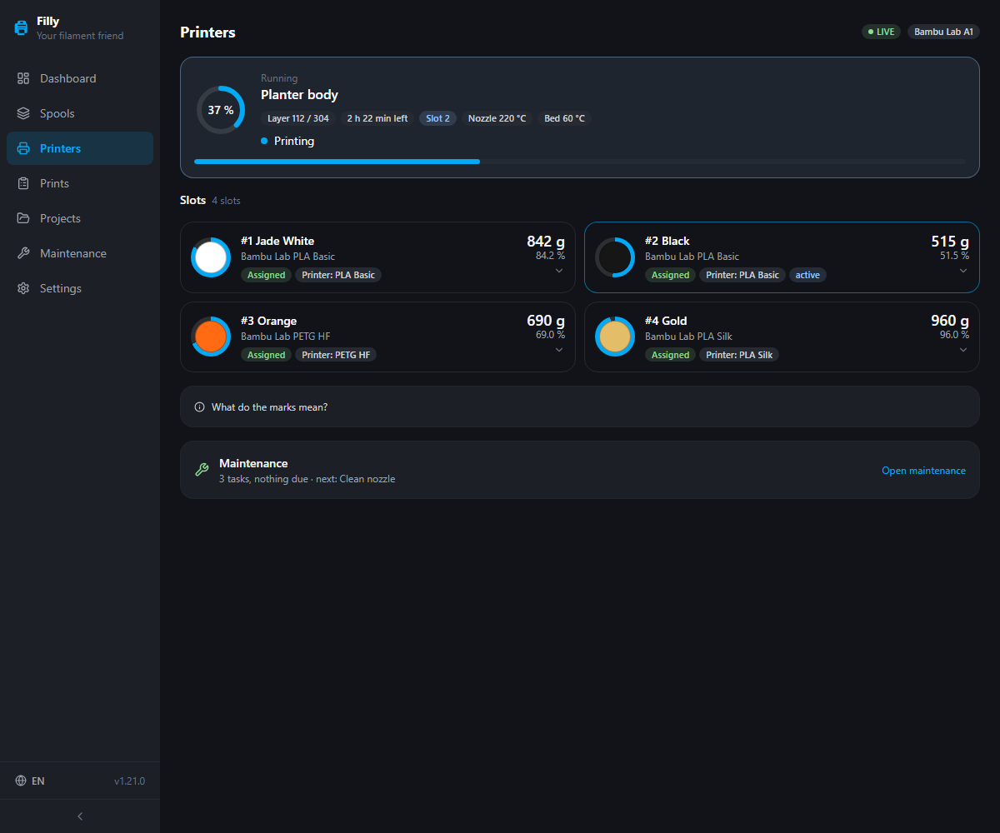

**Prints, projects and maintenance**

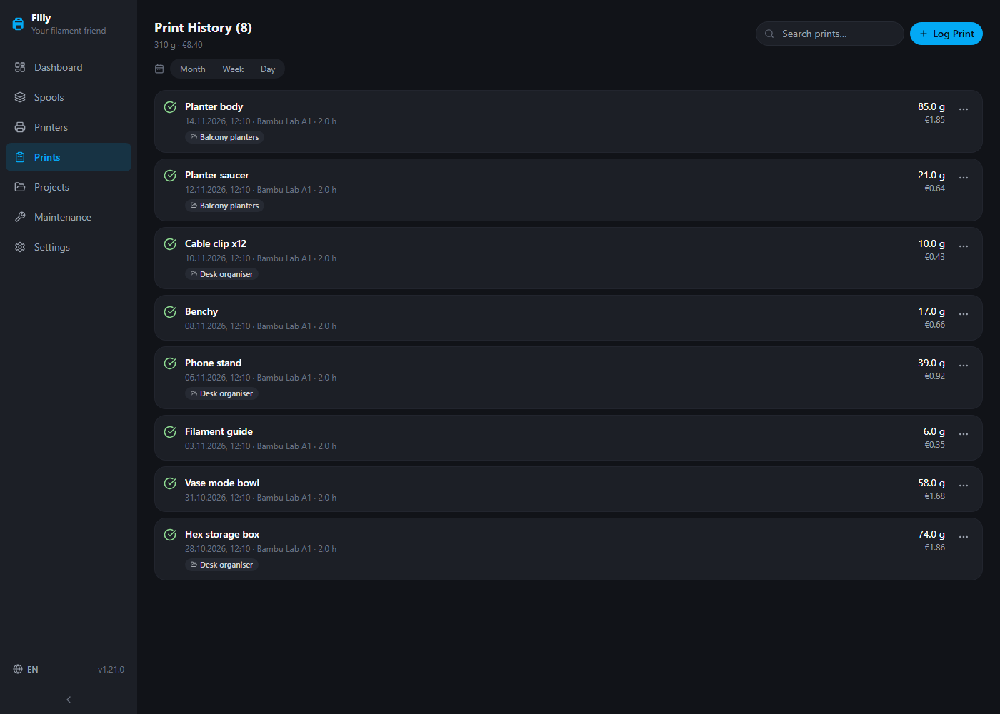
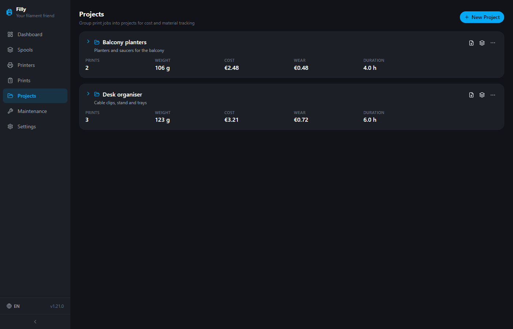
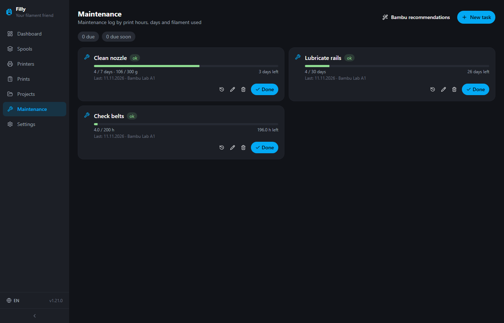

**Share collection (optional, [guide](docs/SHARE.md))**: the dialog with links, and the public page a visitor sees

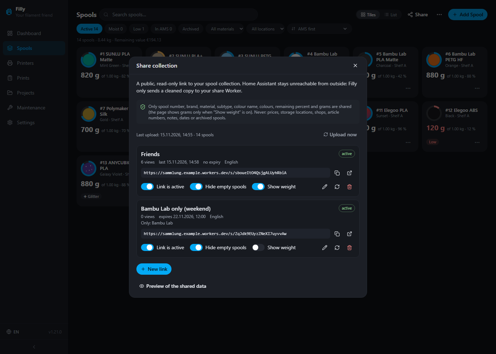
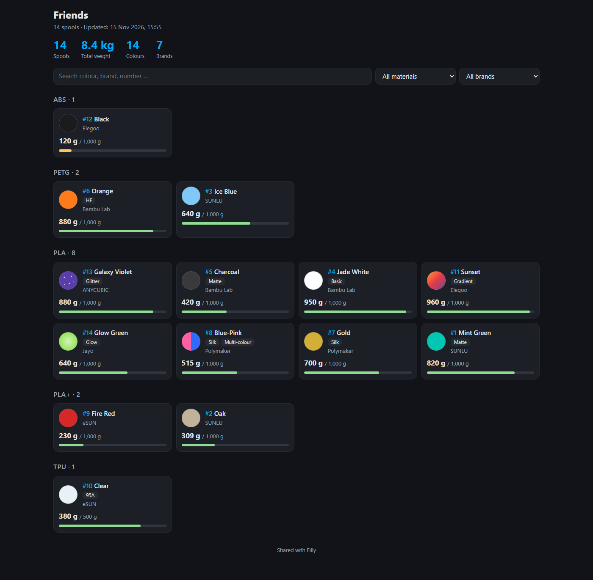

**On the phone** (bottom navigation, list, detail sheet)

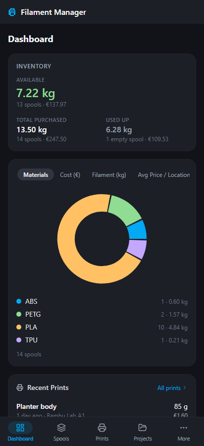 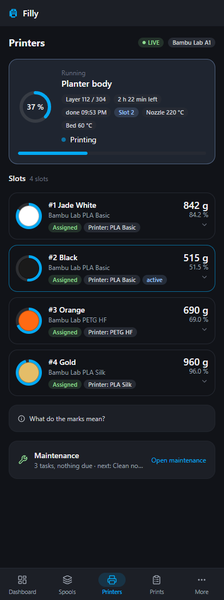 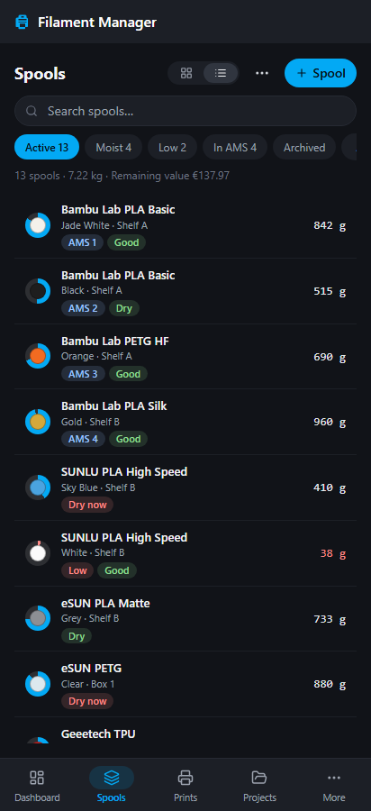 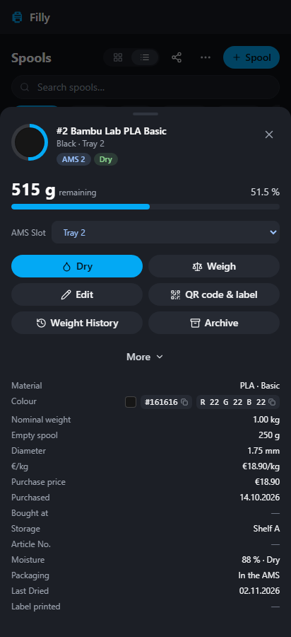

---

## Features

**Print tracking and inventory**

- **Automatic print detection** — monitors your Bambu Lab printer via Bambu Cloud MQTT; creates print records automatically when a print starts
- **AMS filament tracking** — snapshots filament levels at print start/end; calculates grams used per spool per tray; multi-spool prints (runout swaps, AMS auto-switches) are detected
- **Suggested filament usage** — on print completion the app pre-fills grams used per tray for review; an optional per-printer *auto-deduct* flag applies it immediately
- **Printers page** — live print card (progress, layer x / y, remaining time, the printer's stage in plain words such as "Changing filament", nozzle and bed temperature) and one card per AMS slot with spool, state, colour as hex and RGB and questions ("Which spool is in AMS 1 · T1?"); maintenance status in one line
- **Silent slot assignment** — a slot with exactly one fitting spool gets it assigned automatically (with Undo), so prints book their grams from the right spool
- **Spool inventory** — brand, material, subtype, colours (up to 4 for multicolour, shown as hex **and** RGB with click-to-copy, e.g. for Bambu Studio), article number, weight, tare, price, purchase and storage location, notes; archive instead of delete; weight history per spool
- **Weigh from the list** — enter the scale reading, the remaining weight is calculated with the spool's own tare
- **AMS spool auto-match** and tray assignment from the spool list; the dashboard asks "Which spool is in AMS 1 · T1?" with ranked candidates (colour compared by perceptual distance, product lines like "PLA+ 2.0" fit the printer's "PLA") and one-click "Assign"
- **Colour modes** — single colour, gradient, multi-colour (dual/tri) and special (glitter, glow, colour change, marble), shown as disc and bar everywhere
- **Manufacturer colours** — about 2,000 bundled colours of SUNLU, Bambu Lab, Polymaker, eSUN, Elegoo, Geeetech, ANYCUBIC, Jayo, TECBEARS and ERYONE (search, brand and material filter); one tap fills brand, material, subtype and colour look into the spool form, or several at once go into the filament catalog. Every colour is marked **official** (manufacturer's own page) or **community** (SpoolmanDB)
- **Share collection** (optional) — public read-only links to your spools (name, expiry, on/off, view counter, hide empty spools, only certain brands or materials, optional weight in grams), served by a small Cloudflare Worker you deploy yourself: [step-by-step guide](docs/SHARE.md), [technical details](share_worker/README.md). Home Assistant stays unreachable from outside; Filly only sends spool number, brand, material, subtype, colour, remaining percent and optionally grams, never prices, locations or notes
- **Filament catalog** with CSV import/export, brand spool weights, optional Bambu Lab filament sync (experimental)
- **Print projects** — group prints (production and test prints) with aggregated time, filament, cost and energy
- **Print history** with search and date filter, description and model URL

**Costs and reports** *(extended in this fork)*

- Material cost per spool price, energy from a kWh sensor and price sensor per printer, **wear per print hour**
- **Project cost overview (PDF)** with switchable items and extra line items; **inventory list (PDF)** grouped by storage location

**Moisture, labels, maintenance** *(new in this fork)*

- **Moisture estimate** per spool with dryer workflow and thresholds
- **Spool labels** with QR code, print profiles, Niimbot D110 (Web Bluetooth), PNG, PDF, A4 grid
- **Maintenance log** with tasks due by hours, days or grams

**Everything else**

- **Dashboard** — key figures, charts, recent prints, low-stock alerts
- **EN / DE / ES** interface, inherits the language from Home Assistant; follows the HA light/dark theme and accent colour
- **Export / import** — full JSON backup/restore, spool CSV, Bambu Cloud print history import, experimental Spoolman export
- **Regional overrides** — time zone, currency and country can be set manually

---

## Requirements

- Home Assistant with Supervisor (Home Assistant OS)
- A Bambu Lab account (email + password) for the cloud connection

---

## Installation

Go to **Settings → Add-ons → Add-on Store** → three-dot menu → **Repositories** → paste `https://github.com/viruz82/filly` → **Add**.

Once "Filly" appears, open it and press **Install**.

The sensors are named `sensor.filament_manager_*` like in the original, so **do not run the original and the fork at the same time** (they would overwrite each other's sensors). To migrate, export the full JSON backup in the original (**Settings → Export / Import**), stop it, then import the file in the fork.

---

## Configuration

1. Open the add-on and go to **Settings → Cloud Config**
2. Under **Bambu Lab Cloud**, enter your Bambu account email and password and click **Connect** (2FA if required)
3. Go to **Settings → Printers → Add Printer**, select your device from the dropdown, and save. Optionally pick an energy sensor, a price sensor and a wear rate (€ per print hour)
4. Add your filament spools under **Spools**

**Label printing:** printing directly on a Niimbot D110 needs Web Bluetooth, i.e. Chrome or Edge on a PC or Android phone, opened over **HTTPS**. Set Home Assistant's external URL (**Settings → System → Network**); the labels' QR code and the "Open in browser" button use it. In the Home Assistant Android app use "Open in browser" (the app's own WebView has no Web Bluetooth).

---

## How It Works

### Automatic Print Tracking

Bambu Lab printers push state changes via MQTT. When `gcode_state` transitions to `RUNNING`, a new print job is created. On `FINISH` / `FAILED` / `IDLE`, the job is closed and filament usage is fetched from the Bambu Cloud task API.

```
idle → RUNNING     Creates print job, fetches real start time + title from cloud
RUNNING → FINISH   Closes job, fetches weight + per-tray breakdown from cloud task API
RUNNING → FAILED   Closes job with failed flag
```

### Filament Consumption

The per-tray breakdown comes from the Bambu Cloud task API (`amsDetailMapping`). The spool's remaining weight is updated automatically when auto-deduct is enabled.

### Cost Tracking

- Price per kg = purchase price ÷ net weight
- Print cost = Σ (grams used × cost per gram) + energy (kWh × price) + wear (print hours × rate)
- Prints without an assigned spool (typical for imported cloud history) are priced with the average price per gram of the same material

### Moisture Estimate

Nothing is measured. Dryness = `100 − days since drying × material factor × packaging factor × 3` (in %). Packaging per spool (sealed, vacuum, drybox, open, in the AMS …) and all factors are adjustable in **Settings**.

### Maintenance

Each task has limits in print hours, days and/or grams of filament; the first limit reached makes it due. Hours and grams are counted from the prints finished since the task was last done.

---

## Home Assistant Sensors

Pushed automatically through the HA States API (no configuration needed):

| Entity | Description |
|---|---|
| `sensor.filament_manager_pending_usages` | Prints awaiting filament usage confirmation |
| `sensor.filament_manager_low_stock_spools` | Spools below the low-stock threshold |
| `sensor.filament_manager_ams_unmatched` | AMS trays with no matching spool |
| `sensor.filament_manager_ams_spools` | AMS slots with an assigned spool (attribute `slots`: printer, slot, name, brand, material, colour, grams, percent) |
| `sensor.filament_manager_moisture_spools` | Spools below the dryness warning threshold |
| `sensor.filament_manager_maintenance_due` | Maintenance tasks that are due (attributes list all tasks) |
| `sensor.filament_manager_last_print` | Last print; attributes include `material_cost`, `energy_cost`, `wear_cost` |
| `sensor.filament_manager_total_spools`, `_consumed_spools` | Spool counts |
| `sensor.filament_manager_printer_<name>_status` | Live status per printer |
| `sensor.filament_manager_filament_used`, `_prints`, `_print_hours`, `_cost_total`, `_cost_material`, `_cost_energy`, `_cost_wear`, `_stock_weight`, `_stock_value` | **Long-term statistics** (with `state_class`, usable in statistics graphs) |
| `sensor.filament_manager_statistics` | One snapshot for dashboards (windows with trend, stock levels, top lists, forecast) |

---

## Data & Persistence

- Database: SQLite at `/data/filament.db` (survives updates)
- Schema migrations run automatically on startup
- Version series of the fork: new feature = second digit, fix = third digit; every version has a Git tag

---

## License

MIT License. Not affiliated with Bambu Lab, Niimbot or Home Assistant.

**Colour data** (`filament_manager/backend/app/data/manufacturer_colors.json`, built by `tools/build_manufacturer_colors.py`): community values come from [SpoolmanDB](https://github.com/Donkie/SpoolmanDB) (MIT License, Copyright (c) 2024 Donkie; the commit used is recorded in the file); official values come from the manufacturers' own pages (SUNLU product pages, Polymaker wiki "HEX Codes and Transmission Distances"). Brand names belong to their owners. Hex values are guide values; screen colours differ from the printed filament.

---

## Original author

The original add-on is by [cgradl](https://github.com/cgradl/filament-manager). Check out the author's 3D models at https://makerworld.com/en/@carasak/
