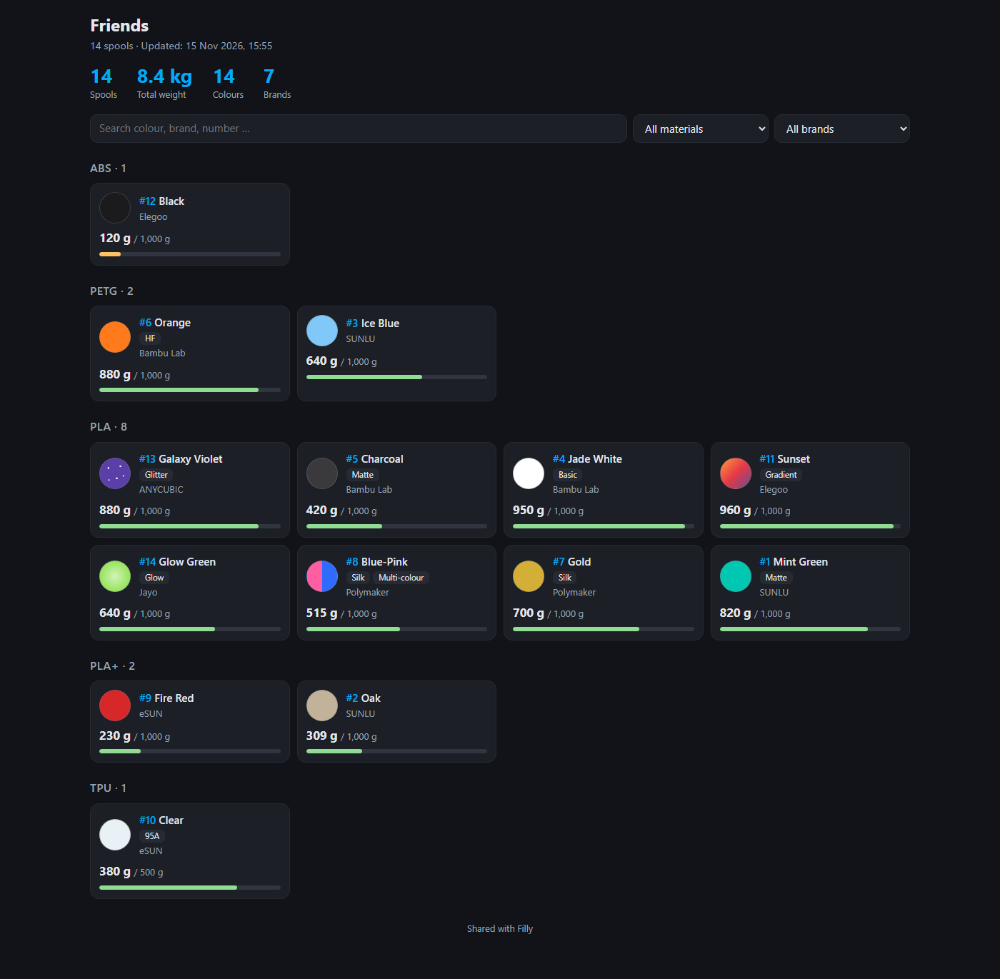
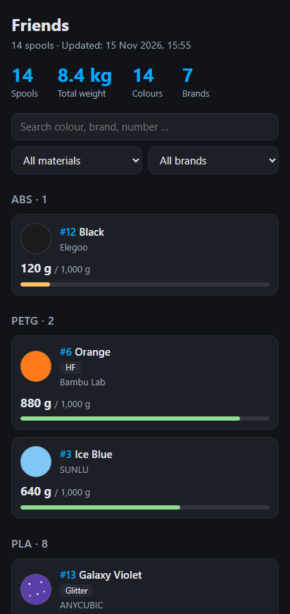
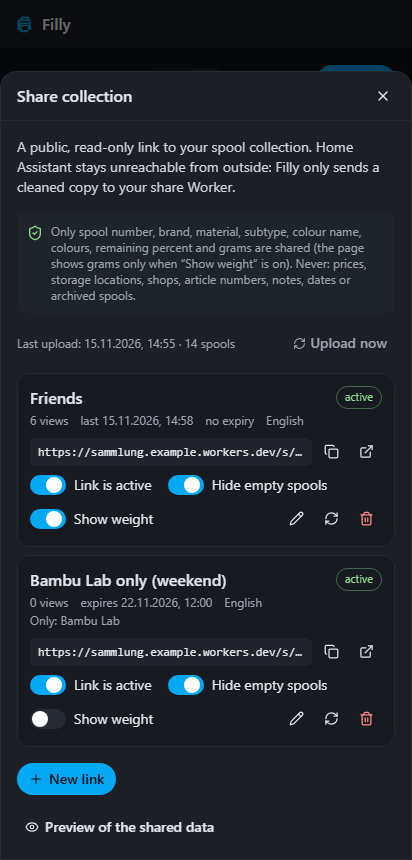
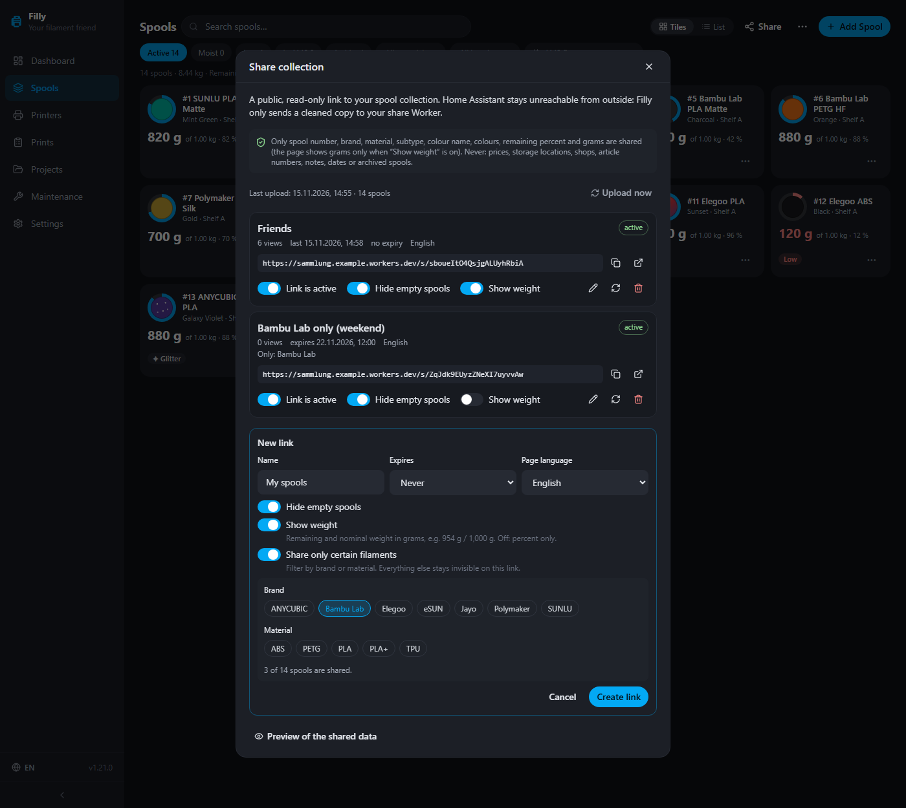

# Share your collection (optional)

Filly can publish a **read-only page** of your spools under a link that nobody can guess, for example
to show friends which colours you own or to let someone tell you "print this with spool #38".

Your Home Assistant is **never reachable from the internet** for this. Filly only *sends* a cleaned
copy of your collection to a small [Cloudflare Worker](https://developers.cloudflare.com/workers/)
that you deploy in your own free Cloudflare account. Visitors only talk to that Worker.

```
Home Assistant (Filly)  ──sends cleaned copy──▶  your Cloudflare Worker  ◀── visitors open the link
        (stays private)
```

This guide takes about 15 minutes. You need no server and no domain of your own.

What a visitor sees (demo data, light/dark follows the visitor's device):



On the phone:  

## What is shared and what is not

Only these fields per spool leave your Home Assistant (checked in Filly **and** again in the Worker):

| Shared | Never shared |
|---|---|
| spool number, brand, material, subtype | prices, shops, purchase and storage locations |
| colour name, colours, colour mode / effect | notes, article numbers, AMS slots |
| remaining percent | dates, ids, print history |
| remaining and nominal grams (only if "Show weight" is on for that link) | archived spools |

You can limit a link to certain brands or materials. Spools that a link filters out never reach its page.

## What you need

- A free Cloudflare account (cloudflare.com) with a `workers.dev` subdomain (Cloudflare asks for one
  when you open Workers for the first time)
- A computer with [Node.js](https://nodejs.org/) 22.12 or newer
- The Filly source code (this repository), folder `share_worker/`
- Filly 1.20.0 or newer

## Step 1: Get the Worker code

```sh
git clone https://github.com/viruz82/filly.git
cd filly/share_worker
npm install
```

## Step 2: Log in to Cloudflare

Pick **one** of the two ways.

**A) Interactive (easiest):**

```sh
npx wrangler login
```

A browser window opens, you approve access. Nothing else to set.

**B) With an API token** (for scripts): in the Cloudflare dashboard create an API token with the
permission **Workers Scripts: Edit** for your account and note your **Account ID**. Then set them in
your shell (use your own values, never put them into a file in the repository):

```sh
export CLOUDFLARE_API_TOKEN=<your token>
export CLOUDFLARE_ACCOUNT_ID=<your account id>
```

(Windows PowerShell: `$env:CLOUDFLARE_API_TOKEN = '<your token>'`.)

## Step 3: Deploy the Worker

```sh
npx wrangler deploy
```

At the end it prints the address of your Worker:
`https://sammlung.<your-subdomain>.workers.dev`. Write it down, this is your **Worker address**.
(You can rename the Worker by changing `name` in `wrangler.toml` before you deploy.)

## Step 4: Set a key

The key is a password between Filly and your Worker. Use a long random one, at least 32 characters:

```sh
openssl rand -base64 32      # prints a key, copy it
npx wrangler secret put PUSH_KEY
```

`wrangler` asks for the value, paste the key. Keep the key somewhere safe (a password manager), you
need it once more in the next step. It is not shown again by Cloudflare.

## Step 5: Tell Filly

In Home Assistant open **Settings → Add-ons → Filly → Configuration** and fill in:

| Option | Value |
|---|---|
| **Share – Worker address** (`share_url`) | `https://sammlung.<your-subdomain>.workers.dev` (https, no path) |
| **Share – key** (`share_key`) | the same key you set as `PUSH_KEY` |

Save and **restart** the add-on. The key lives in the add-on options only: it is not in the database,
not in the JSON export and never reaches your browser.

## Step 6: Create a link

1. Open Filly and go to **Spools**, press **Share**.
2. The dialog shows "Last upload". Press **Upload now** once to send the first copy.
3. **New link**: choose a name, how long it stays valid (never / 1 / 7 / 30 / 90 days) and the page
   language. Options:
   - **Hide empty spools**
   - **Show weight**: grams as `954 g / 1,000 g`; off = percent only
   - **Share only certain filaments**: pick brands and/or materials; empty = everything
4. **Create link**. The address is copied. Send it to whoever should see your collection.



Later you can switch a link off, change its options, create a **New address** (the old one stops working
and the counter restarts), or delete it. The dialog also shows how often and when a link was last viewed.

Filly uploads again by itself whenever something changed, at most every 5 minutes.

## Costs and limits

The free Workers plan is enough: 100,000 requests and 100,000 written rows per day. Every page view
writes one row (the view counter). If a limit is ever reached, requests fail until 00:00 UTC. The free
plan does not bill you.

## Troubleshooting

The dialog shows these messages:

| Message | Cause and fix |
|---|---|
| "Sharing is not set up yet" | `share_url` or `share_key` empty. Fill both in the add-on configuration and restart |
| "The Worker address in the add-on configuration is invalid" | Must be `https://…` without a path, e.g. no `/api` at the end |
| "The key … is too short" | Use at least 32 characters (Step 4) |
| "The share Worker cannot be reached" | Address wrong, Worker not deployed, or no internet from Home Assistant. Open the address in a browser: it should answer, not time out |
| "The share Worker rejects the key" | `share_key` differs from `PUSH_KEY`. Set the secret again (`npx wrangler secret put PUSH_KEY`) and use the same value in Filly |
| "The share Worker reports an error" | Update the Worker to the version that matches your Filly (`git pull`, `npx wrangler deploy`), then press **Upload now** again |

A link that does not exist, is switched off or has expired always shows the same neutral "not available" page.

## Updating the Worker

After a Filly update that mentions the Worker in the changelog, update it too:

```sh
cd filly && git pull
cd share_worker && npm install && npx wrangler deploy
```

Your key (`PUSH_KEY`), links and view counters stay as they are.

## Removing everything

Delete the links in the dialog, empty `share_url` and `share_key` in the add-on configuration and
delete the Worker in the Cloudflare dashboard (Workers & Pages). Nothing is left in Filly.

More technical details (API, data model, tests): [share_worker/README.md](../share_worker/README.md).
